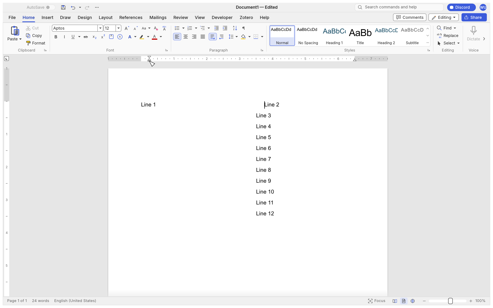

# Active-column ruler regression (#2196)

Synthetic English document, Letter paper, 72pt margins, two 216pt columns with a
36pt gap. `Line 1` remains in column 1; a column break at the start of `Line 2`
puts the caret and the following text in column 2.

The old ruler measured from the page body (72pt, 468pt), although the placed
piece containing the caret starts at 324pt and its column is 216pt wide. After
an 18pt left-indent drag, the paragraph starts at 342pt but the old marker is
at 90pt. The displacement is 252pt in both states.

The fix finds the `Placed::Lines` piece whose `l0..l1` contains the caret's
line and matches its column x against the caret section's `column_boxes()`.
It uses that column's origin and width for the markers, tab frame and pointer
conversion. It does not infer a column from the caret's visual x, which changes
with indentation and alignment. Table-cell text areas retain precedence.
Non-body stories and non-print views retain their existing body fallback.

## Replay and images

From the repository root:

```powershell
cargo run -p wordcraft-ui-egui --example ui_shot -- docs/testing/2196-ruler-columns/after.jsonl
```

`before.jsonl` is the baseline replay. Its drag starts at the old marker's
screen x=412; `after.jsonl` starts at x=748, above the active column. Each drag
moves 24 screen points, or 18 document points at 100%. Both scripts wait for
the queued pointer events before inspecting the document and capturing it.
The after script also clicks into column 1, clicks back into column 2, and
switches to 60% zoom. The window is 1440×900 points at 2× pixel density.

| State | Before | After |
|---|---|---|
| Caret in column 2 |  |  |
| After dragging 18pt |  |  |

Additional captures: [column 1](after-column1.png),
[return to column 2](after-return-column2.png), [60% zoom](after-zoom60.png).
These are original offscreen WordCraft captures of synthetic text.

## Automated coverage

`crates/ui-egui/src/ruler_columns_tests.rs` uses the full window and inspects the
three painted triangles, then sends real pointer presses, moves and releases.
Its matrix covers equal/unequal columns, LTR/RTL sections, independent LTR/RTL
paragraphs, 60%/150% zoom, crossing columns within one paragraph, moving back,
and left/right/first-line drags. It verifies the resulting paragraph properties
and that another paragraph is unchanged. Separate tests cover single columns,
table-cell precedence, invalid page hints and continuous sections sharing a page.
The existing table-ruler pointer regression remains in `table_resize.rs`.

Validation (Windows, upstream main `86adfd34eb2d3916a571e84b6605ec642e274440`):

- Restoring the two original ruler expressions makes the painted-marker matrix
  and continuous-section regression fail (2 failed, 2 passed), as expected.
- With the fix: `cargo test --locked -p wordcraft-ui-egui --lib ruler` passes
  all 18 ruler tests, including the existing #700 pointer regressions.
- Both `ui_shot` replays ran successfully. All seven captured images were opened
  and inspected. The document inspection confirms an 18pt left indent after
  each replay's drag. Before images were regenerated on the current-main build
  with the original ruler expressions restored, then the fix was restored.
- `cargo xtask ci`: **failed** at workspace tests. Fmt and Clippy passed.
  `wordcraft-render` has two failing system-font tests:
  `tests_color_glyphs::emoji_are_drawn_in_colour` and
  `tests_color_glyphs::emoji_keep_their_colours_on_a_dark_page`. Both fail at
  `tests_color_glyphs.rs:74`: expected 2 colour-font glyphs, observed 1.
- The separate workspace run excluding `wordcraft-render` found one additional
  failure: `keys::tests::alt_numpad_code_types_its_character_without_keytips`
  (`keys.rs:691`), expected `é`, observed Hebrew `י`. Its UI crate result was
  554 passed, 1 failed, 2 ignored. The test uses the system code page; its expected
  character does not match this Windows environment. The keys, render, fonts,
  layout and dependency files are unchanged from upstream main.
- Separate assets and layers checks passed (62 attributed assets, 20 crates).
- `cargo test --locked --workspace --no-fail-fast`: 2,759 passed, 3 failed,
  2 ignored across 77 test binaries and doc-test targets. It completed all targets
  and reproduced exactly the three failures above. **Overall CI is not green.**
- `cargo xtask wasm`: all 16 WASM package checks passed.

## Related work and boundaries

- #700 is closed; its table-cell origin and table-border gestures are preserved.
- #1878 / PR #2093 is now merged. The rebase retains its label density, clipping,
  active-page scaling and collision handling. `ruler_text_area` is called at its
  moved calculation, before both label collision detection and marker/tab painting.
- #2914 / PR #2975 is now merged. Visible-edge margin gestures on even mirrored
  pages retain the upstream mapping to stored margins.
- #1158 remains outside scope: no floating-shape wrap or pagination policy changes.
- Section and paragraph direction are explicit settings. English is used in
  every matrix case; this change introduces no language-based direction policy.

No live Word window comparison was performed.

Environment limitation: `../../craftrules/AGENTS.md` was absent and its GitHub
repository returned 404. The issue attachments returned network-filter placeholder
images, so their original pixels could not be inspected; the issue body was read
and its reproduction was independently captured and inspected locally. Git smart
HTTP returned 418; the exact upstream main snapshot and missing pinned dependency
were retrieved through GitHub's Git API and verified against their Git object IDs.

## Rebase compatibility (2026-10-21)

Rebased onto upstream main `e05b7fe8` with all upstream behavior retained.
The code conflict overlaps PR #2093's relocation of the ruler frame: resolving
only the later indent block would calculate label collisions and tabs against
the page body while drawing indents against the column. The integrated version
uses one active-column frame throughout.

Two added pointer/paint regressions exercise indent/tab label avoidance in the
second column in both reading directions, and the negative start-indent limit
at the right page edge of an unequal RTL column. Existing ruler tests also cover
upstream active-page layout, zoom density and mirrored-margin gestures.

Rebase validation on Windows:

- All 27 ruler tests passed, including the new integration regressions.
- `cargo xtask ci`: formatting and workspace Clippy (`-D warnings`) passed.
  The workspace test build was stopped when free disk space fell below 3 GB;
  the complete workspace test suite was not run to completion on this revision.
- Asset attribution (62 files) and dependency layering (20 crates) passed.
- Two local headless captures at 100% and 60% zoom were generated and inspected;
  these additional audit captures are not included in the PR.
- `cargo xtask wasm`: all 16 package checks passed.
